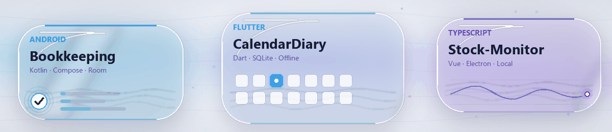

<!-- markdownlint-disable MD033 MD013 MD041 -->

  

<h1 align="center">你好，我是 bdpqer</h1>

  

  
  
  

  
  

---

## 关于我

- 喜欢从真实需求出发，做能长期使用的工具。
- 最近主要在做 Android / Flutter 应用，也写一些 TypeScript、Python 和 C。
- 偏好本地优先、离线可用、隐私友好的设计与实现。
- 正在练习把复杂问题拆成清晰、可维护的小模块。

## 技术栈

  

## 精选项目

| 项目 | 简介 | 技术 |
| --- | --- | --- |
| [Bookkeeping](https://github.com/bdpqer/Bookkeeping) | 离线优先的 Android 自动记账，支持通知 / 短信解析、语音记账与本地备份。 | Kotlin · Compose · Room |
| [CalendarDiary](https://github.com/bdpqer/CalendarDiary) | Flutter 日历与多媒体日记，支持农历、节假日、事项提醒与本地存储。 | Flutter · Dart · SQLite |
| [DyDown](https://github.com/bdpqer/DyDown) | Android 抖音下载器，支持视频、图集、主页批量与直播录制。 | Kotlin · Android |
| [Stock-Monitor](https://github.com/bdpqer/Stock-Monitor) | Windows 桌面自选股工具的离线维护版，支持置顶悬浮与本地配置。 | TypeScript · Vue · Electron |
| [LocationAlarm](https://github.com/bdpqer/locationalarm) | 基于位置的 Android 闹钟，支持自定义范围与本地持久化。 | Kotlin · Compose · Room |

## GitHub 数据

  
  

## 更多

- [全部公开仓库](https://github.com/bdpqer?tab=repositories)
- [GitHub 个人主页](https://github.com/bdpqer)
- 欢迎通过 [Issues](https://github.com/bdpqer/bdpqer/issues) 交流项目想法或工具使用体验。

持续构建，保持好奇。

